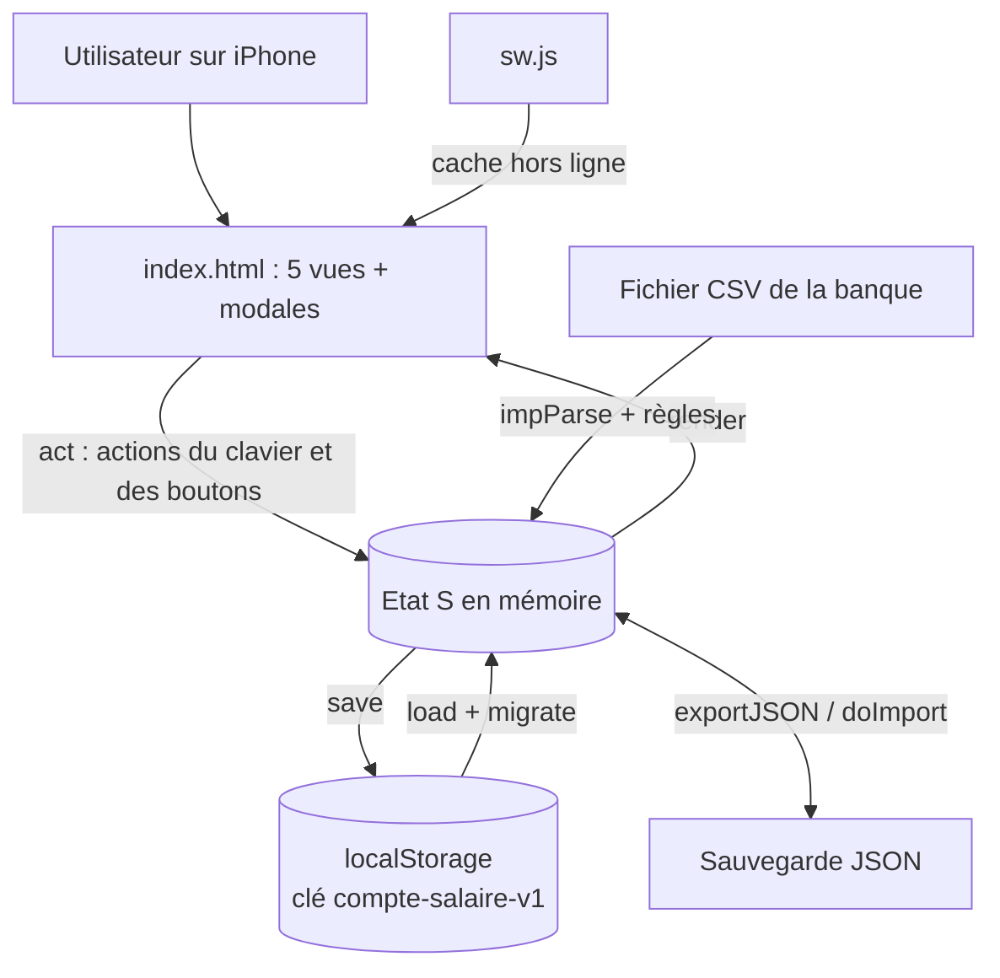

# Architecture — Mon Compte

Application de suivi de budget **100 % locale** : une PWA sans serveur, sans framework, sans dépendance. Tout le code applicatif tient dans `index.html` (HTML + CSS + JavaScript).

## Fichiers du dépôt

| Fichier | Rôle |
|---|---|
| `index.html` | Toute l'application : styles, structure, logique, rendu |
| `manifest.json` | Déclaration PWA (nom « Mon Compte », affichage plein écran, couleur `#0f766e`, icônes) |
| `sw.js` | Service worker : réseau d'abord, cache en secours pour le hors ligne |
| `icon-180.png`, `icon-512.png` | Icônes de l'app (iPhone et maskable) |
| `LICENSE`, `README.md` | Mention « Tous droits réservés » |
| `JOURNAL.md` | Carnet de bord du projet |
| `ARCHITECTURE.md` | Ce document |

## Vue d'ensemble

Principe : une seule variable d'état `S`, modifiée par les actions, enregistrée par `save()`, puis l'écran est entièrement reconstruit par `render()` (pas de rendu partiel, sauf `refreshList` pour la liste des lignes).

## Stockage et données

- Stockage : `localStorage`, clé `compte-salaire-v1`. Rien n'est envoyé sur le réseau.
- Sauvegarde manuelle : export JSON (feuille de partage iOS) et restauration depuis un fichier. L'app rappelle de sauvegarder après 30 jours.
- `migrate()` met à niveau les anciennes données à chaque chargement (version de schéma `v:2`).

Contenu de l'état `S` :

| Champ | Contenu |
|---|---|
| `accounts` | Comptes : nom, type (`courant`, `livret`, `credit`, `differe`, `emprunt`), solde repère (`anchor`), inclusion dans le reste à vivre (`cash`), plafond, compte et jour de débit pour le différé |
| `shown` | Comptes cochés dans la vue consolidée |
| `tx` | Lignes réelles : date, libellé, montant, catégorie, sous-catégorie, tiers, compte, lien de virement, clé de récurrence |
| `rec` | Récurrences : fréquence, jour, début/fin, montant (avec changements datés), compte, mot-clé CSV |
| `plans` | Paiements en plusieurs fois : liste d'échéances mensuelles |
| `rules` | Règles de classement automatique (mot-clé vers catégorie) |
| `budgets` | Budgets par catégorie ou sous-catégorie |
| `csvMaps` | Correspondance de colonnes mémorisée par format de CSV |
| `skips` | Échéances ignorées |
| `lastExport` | Date de la dernière sauvegarde |

Catégories (constante `CATS`) : Revenus, Logement, Voiture, Alimentation, Santé, Loisirs, Finances, Divers, chacune avec ses sous-catégories. Les restaurants et bars sont volontairement dans Loisirs.

## Interface

Navigation en bas, 5 vues (objet `VIEWS`) :

| Vue | Fonction | Contenu |
|---|---|---|
| Accueil | `homeHTML` | Solde, graphique, répartition, bloc « Sortir du découvert », rappel de sauvegarde, échéances à valider |
| Lignes | `linesHTML` | Liste filtrable, sélection multiple et modification groupée |
| Récurrent | `recHTML` | Échéances à valider, récurrences, paiements en plusieurs fois |
| Import | `impHTML` | Import CSV avec choix des colonnes |
| Réglages | `setHTML` | Comptes, budgets, règles, sauvegarde et restauration |

Les formulaires sont des modales (`openTx`, `openAcc`, `openRec`, `openPlan`, `openXfer`, `openBulk`), enregistrées par les fonctions `save…`. Un seul gestionnaire d'événements, `act()`, répartit les actions via les attributs `data-a`.

## Logique métier

| Domaine | Fonctions clés |
|---|---|
| Soldes | `balanceAt`, `accBalance`, `adjRows` (ligne « Ajustement de solde » recalculée pour que le solde repère reste juste), `withBalance` |
| Virements et emprunts | `createTransfer`, `linkTransfer`, `unlinkTransfer`, `xferOther` : deux lignes liées, montant et date répercutés |
| Récurrences | `occ` (dates d'une récurrence dans un mois), `amountAt` (montant à une date), `dueItems` / `dueRange` (échéances non encore validées ni ignorées), `changeAmount` (nouveau montant à partir d'une date) |
| Paiements en plusieurs fois | `makePlanItems`, `planStats`, `planKeys` |
| Débit différé | `debitDates`, `creditInfo` (cartes et crédits) |
| Classement | `autoCat`, `kwFrom`, `linkRec` (rapprochement d'une ligne avec une récurrence) |
| Import CSV | `parseCSV`, `parseAmount`, `parseDate`, `guessCol`, `impParse`, `doImport`, `onFile` |
| Période | `range`, `setAnchor`, `shiftPeriod`, `periodLabel` (jour, semaine, mois, année) |

Cycle d'une échéance : la récurrence génère une échéance « à valider » ; **Valider** ouvre une ligne pré-remplie que l'on confirme, **Ignorer** l'ajoute à `skips`. Dans les deux cas elle disparaît de la liste (clé `recKey` ou `skips`).

## Mise à jour et déploiement

- Hébergement : GitHub Pages à partir du dépôt (branche par défaut `main`).
- Le service worker (`sw.js`) a une version de cache (constante `V`, actuellement `compte-v17`). **À chaque modification publiée, incrémenter cette version** pour que l'iPhone récupère la nouvelle app.
- Aucune étape de build : modifier `index.html`, commiter, pousser.
