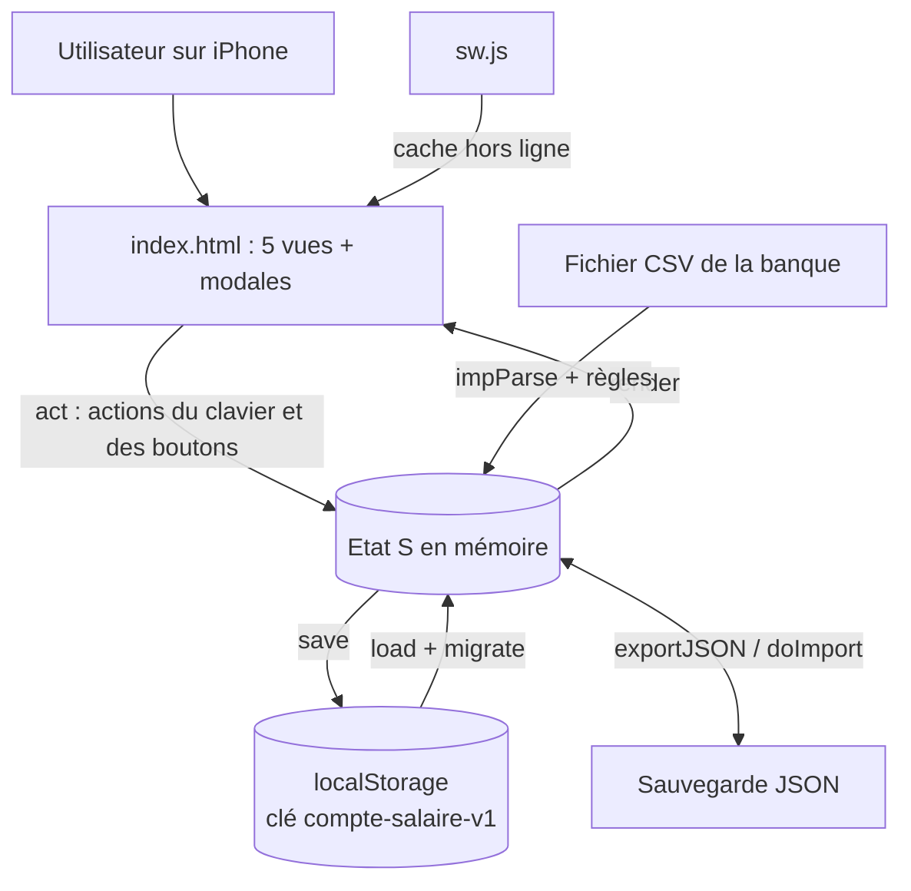
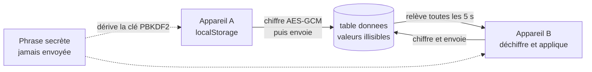

# Architecture — Mon Compte

Application de suivi de budget **locale d'abord** : une PWA sans framework et sans dépendance. Tout le code applicatif tient dans `index.html` (HTML + CSS + JavaScript). Les données restent dans le `localStorage` de l'appareil ; depuis la synchronisation (voir plus bas), une copie **chiffrée** peut être envoyée à un compte personnel pour retrouver les mêmes comptes sur plusieurs appareils.

## Fichiers du dépôt

| Fichier | Rôle |
|---|---|
| `index.html` | Toute l'application : styles, structure, logique, rendu |
| `manifest.json` | Déclaration PWA (nom « Mon Compte », affichage plein écran, couleur `#0f766e`, icônes) |
| `sw.js` | Service worker : réseau d'abord, cache en secours pour le hors ligne |
| `icon-180.png`, `icon-512.png` | Icônes de l'app (iPhone et maskable) |
| `LICENSE`, `README.md` | Mention « Tous droits réservés » |
| `tests/test_sync.py` | Tests de la synchronisation (faux serveur, deux appareils simulés) ; voir `tests/README.md` |
| `tests/test_rappel_et_hors_ligne.py` | Tests du rappel de sauvegarde partagé et de la bannière « Hors ligne » |
| `tests/test_regles_et_tiers.py` | Tests de la catégorie Animaux, des tiers en majuscules, du libellé facultatif et des règles dans Réglages |
| `tests/test_replis.py` | Tests des menus repliables de Réglages (cartes et groupes d'organismes) |
| `JOURNAL.md` | Carnet de bord du projet |
| `ARCHITECTURE.md` | Ce document |

## Vue d'ensemble

Principe : une seule variable d'état `S`, modifiée par les actions, enregistrée par `save()`, puis l'écran est entièrement reconstruit par `render()` (pas de rendu partiel, sauf `refreshList` pour la liste des lignes).

## Stockage et données

- Stockage : `localStorage`, clé `compte-salaire-v1`. Sans connexion à un compte, rien n'est envoyé sur le réseau.
- Sauvegarde manuelle : export JSON (feuille de partage iOS) et restauration depuis un fichier. **Rappel de sauvegarde** (depuis `compte-v20`, sur toutes les vues depuis `compte-v21`) : même logique que Plan du jour, voir « Rappel de sauvegarde » plus bas.
- `migrate()` met à niveau les anciennes données à chaque chargement (version de schéma `v:2`).

Contenu de l'état `S` :

| Champ | Contenu |
|---|---|
| `accounts` | Comptes : nom, type (`courant`, `livret`, `credit`, `differe`, `emprunt`), solde repère (`anchor`), inclusion dans le reste à vivre (`cash`), plafond, compte et jour de débit pour le différé |
| `shown` | Comptes cochés dans la vue consolidée |
| `tx` | Lignes réelles : date, libellé, montant, catégorie, sous-catégorie, tiers, compte, lien de virement, clé de récurrence |
| `rec` | Récurrences : fréquence, jour, début/fin, montant (avec changements datés), compte, mot-clé CSV |
| `plans` | Paiements en plusieurs fois : liste d'échéances mensuelles |
| `rules` | Règles de classement automatique (mot-clé, catégorie, sous-catégorie, tiers facultatif), **dans l'ordre de priorité** : la première qui correspond l'emporte |
| `budgets` | Budgets par catégorie ou sous-catégorie |
| `accounts[].od`, `payLim`, `payDays`, `wdLim`, `wdDays` | Compte courant : autorisation de découvert, plafond de paiement par carte (et sa fenêtre glissante en jours, 30 par défaut), plafond de retrait (7 jours par défaut) ; absents = non suivis |
| `payDates` | Dates de paie modifiées à la main, `{'AAAA-MM': 'AAAA-MM-JJ'}` ; absent = règle (voir « Budget du jour ») |
| `csvMaps` | Correspondance de colonnes mémorisée par format de CSV |
| `skips` | Échéances ignorées |
| `lastExport` | Date de la dernière sauvegarde |
| `bk` | État du rappel de sauvegarde : `since` (date de la première modification non sauvegardée), `snooze` (rappel reporté jusqu'à), `every` (délai en jours : 0, 3, 7, 14 ou 30 ; 7 par défaut) |

Catégories (constante `CATS`) : Revenus, Logement, Voiture, Alimentation, Santé, Animaux, Loisirs, Finances, Divers, chacune avec ses sous-catégories. Les restaurants et bars sont volontairement dans Loisirs.

**Tiers** : toujours en majuscules (`upP`), à la saisie et à l'import ; `migrate()` met en majuscules ceux déjà présents (lignes, récurrences, paiements, règles) et, si quelque chose a changé (`payFixed`), l'app enregistre une fois au démarrage. Le **libellé** est le texte de la banque à l'import (sert aux règles et aux doublons) ; en saisie manuelle il est facultatif et prend le tiers s'il est vide.

## Interface

Navigation en bas, 5 vues (objet `VIEWS`) :

| Vue | Fonction | Contenu |
|---|---|---|
| Accueil | `homeHTML` | Carte « Budget du jour », cartes de découvert et plafonds (`cardsHTML`), solde, graphique, répartition, bloc « Sortir du découvert », échéances à valider (le rappel de sauvegarde est en tête de toutes les vues) |
| Lignes | `linesHTML` | Liste filtrable, sélection multiple et modification groupée |
| Récurrent | `recHTML` | Échéances à valider, récurrences, paiements en plusieurs fois |
| Import | `impHTML` | Import CSV avec choix des colonnes |
| Réglages | `setHTML` | Menus repliables : Comptes (groupés par organisme), budgets, jours de paie, règles, synchronisation, sauvegarde et restauration, zone dangereuse |

Les formulaires sont des modales (`openTx`, `openAcc`, `openRec`, `openPlan`, `openXfer`, `openBulk`), enregistrées par les fonctions `save…`. Un seul gestionnaire d'événements, `act()`, répartit les actions via les attributs `data-a`.

## Logique métier

| Domaine | Fonctions clés |
|---|---|
| Soldes | `balanceAt`, `accBalance`, `adjRows` (ligne « Ajustement de solde » recalculée pour que le solde repère reste juste), `withBalance` |
| Virements et emprunts | `createTransfer`, `linkTransfer`, `unlinkTransfer`, `xferOther` : deux lignes liées, montant et date répercutés |
| Récurrences | `occ` (dates d'une récurrence dans un mois), `amountAt` (montant à une date), `dueItems` / `dueRange` (échéances non encore validées ni ignorées), `changeAmount` (nouveau montant à partir d'une date) |
| Paiements en plusieurs fois | `makePlanItems`, `planStats`, `planKeys` |
| Débit différé | `debitDates` |
| Carte de crédit | `creditInfo` : **le solde de la carte est le montant encore disponible** ; dette = plafond − solde (plafond 3000, solde 2500 : dû 500). Solde négatif = plafond dépassé. Achat = ligne négative (le disponible baisse), remboursement = ligne positive (il remonte). **Dans tout total** (`openingSum` : solde des comptes cochés, reste à vivre, solde courant de la liste des lignes), la carte pèse sa dette, soit solde − plafond (−500 dans l'exemple) ; « Compter dans le reste à vivre » décide si cette dette est déduite du reste à vivre. Choisir ce type dans la fiche d'un compte décoche cette case |
| Classement | `autoCat` (première règle correspondante), `kwFrom`, `linkRec` (rapprochement d'une ligne avec une récurrence) |
| Règles (Réglages) | `openRule`, `saveRule`, `ruleLines` (lignes existantes concernées), `openRulePreview` / `applyRulePreview` (aperçu à cocher avant reclassement), `moveRule` (ordre) |
| Import CSV | `parseCSV`, `parseAmount`, `parseDate`, `guessCol`, `impParse`, `doImport`, `onFile` |
| Période | `range`, `setAnchor`, `shiftPeriod`, `periodLabel` (jour, semaine, mois, année) |

Cycle d'une échéance : la récurrence génère une échéance « à valider » ; **Valider** ouvre une ligne pré-remplie que l'on confirme, **Ignorer** l'ajoute à `skips`. Dans les deux cas elle disparaît de la liste (clé `recKey` ou `skips`).

## Budget du jour (façon Money Coach)

Carte en tête de l'Accueil (`budgetCardHTML`, calcul dans `budgetInfo(date)`), masquée tant qu'il n'y a aucune ligne ou aucun compte « reste à vivre » coché.

- **Période** (`payCycle`) : du jour de paie à la veille de la paie suivante. Jour de paie (`payDate` → `payRule`) : **2 jours ouvrés avant le dernier jour ouvré du mois** ; **décembre : 7 jours plus tôt**. Jour ouvré = lundi à vendredi hors jours fériés français (`isWorkday`, `holidays` : 1er janv., lundi de Pâques, 1er mai, 8 mai, Ascension, lundi de Pentecôte, 14 juillet, 15 août, 1er nov., 11 nov., 25 déc. ; `easter` calcule Pâques). Une date modifiée à la main (Réglages › Jours de paie) est dans `S.payDates` (synchronisée) et l'emporte sur la règle.
- **Budget de la période** `B` = reste à vivre d'aujourd'hui (`balanceAt(date, true)` : comptes cochés ET « reste à vivre ») + échéances à venir de la période (`dueRange` : récurrences et paiements en plusieurs fois non validés, de ces mêmes comptes, hors prélèvements de débit différé `noproj` déjà comptés dans le solde). Les échéances en retard non validées de la période comptent comme à venir.
- **Par jour** = (`B` + consommation du jour) ÷ jours restants, aujourd'hui compris ; **aujourd'hui** = par jour − consommation du jour ; **cette semaine** (lundi à dimanche, coupée à la fin de la période) = par jour × jours restants de la semaine − consommation du jour. La consommation du jour = dépenses (montants négatifs) datées d'aujourd'hui sur ces comptes, hors virements (`xfer`) et lignes issues d'une récurrence (`recKey`). Le recalage est automatique : ce qui n'est pas dépensé se répartit sur les jours suivants, ce qui est dépensé en plus les réduit.
- Une carte de crédit hors « reste à vivre » ne change pas le budget ; ses remboursements prévus (récurrences) sont des dépenses à venir.

## Découvert autorisé et plafonds de carte

Pour chaque compte courant ayant au moins un de ces réglages (fiche du compte), l'Accueil affiche une carte (`cardsHTML`, calcul `cardInfo(compte, date)`), sous le budget du jour.

- **Marge** = solde + autorisation de découvert. **Dépassement** = marge négative (solde sous −découvert).
- **Disponible par carte** (règle donnée par l'utilisateur pour sa carte à débit différé : 2000 de découvert, 1500 de plafond) : tant que le découvert n'est pas atteint, c'est le **plafond de paiement restant** (la marge du compte ne bloque pas) ; au-delà, **plafond restant − dépassement** (1500 − 495,18 = 1004,82), jamais négatif. Sans plafond saisi : la marge (solde + découvert). **Disponible en retrait** = plafond de retrait restant, **non réduit** par le dépassement (c'est ce qu'affiche l'appli de sa banque ; il suppose lui-même que la réalité peut différer). La règle réelle de la banque (frais, refus) n'est pas modélisée.
- **Achats non détaillés d'une carte à débit différé** (`undetailed`) : si le solde en attente de la carte (`−accBalance`) dépasse les lignes détaillées depuis son dernier prélèvement (`debitDates(carte, date).last`), la différence compte dans le plafond de paiement (cas d'un solde de référence saisi sans le détail ; pas de double comptage avec les lignes). Les prélèvements des cycles précédents ne sont connus que par leurs lignes détaillées.
- **Plafond restant** = plafond − dépenses de la fenêtre glissante (`payDays`, 30 j par défaut ; `wdDays`, 7 j) : dates > aujourd'hui − N jours et ≤ aujourd'hui. Compte comme paiement par carte : lignes négatives du compte et de ses cartes à débit différé rattachées, **hors** virements (`xfer`), lignes issues d'une récurrence (`recKey`) et retraits. Retrait = sous-catégorie `Divers › Retrait d'espèces` (constante `RETRAIT`). Approximation : un prélèvement importé non rapproché d'une récurrence compte comme paiement par carte ; la fenêtre glissante place les achats non détaillés à leur solde en attente, sans date précise.
- **Prévision** : solde du jour + échéances à venir de la période (`dueRange`, y compris le prélèvement d'une carte à débit différé sur ce compte) ; la carte indique le solde le plus bas prévu, sa date, et « Dépassement prévu » s'il passe sous −découvert.
- **Le découvert n'entre jamais** dans le budget du jour, le reste à vivre ni les totaux (choix de l'utilisateur : c'est une limite à ne pas atteindre).

## Menus repliables de Réglages

- Chaque carte de Réglages est un `
` produit par `foldCard(clé, titre, contenu, ouvertParDéfaut)`. Dans la carte Comptes, chaque organisme (champ « Organisme / groupe » d'un compte) est un `
` de clé `g:<nom>` ; le titre du groupe garde son solde. Sans organisme, ou avec un seul groupe sans nom, la liste des comptes reste plate comme avant.
- Clés des cartes : `comptes`, `budgets`, `paie`, `regles`, `sync`, `sauvegarde`, `danger`. Par défaut : tout est replié (cartes et groupes d'organismes).
- **L'état ouvert / replié est propre à l'appareil** : objet `FOLD` dans le `localStorage` (clé `compte-replis`), hors de `S`, donc jamais synchronisé ni exporté. Il est mis à jour par l'événement `toggle` (écouteur global en capture, car cet événement ne remonte pas) et relu à chaque `render()`, ce qui évite qu'une reconstruction de l'écran referme un menu.
- L'ouverture d'un menu n'est pas une modification : aucun appel à `save()`, donc pas de rappel de sauvegarde ni d'envoi vers la synchronisation.

## Mise à jour et déploiement

- Hébergement : GitHub Pages à partir du dépôt (branche par défaut `main`).
- Le service worker (`sw.js`) a une version de cache (constante `V`, actuellement `compte-v30`). **À chaque modification publiée, incrémenter cette version** pour que l'iPhone récupère la nouvelle app, **et la constante `APP_VERSION` de `index.html`** (même numéro : `22` pour `compte-v22`), affichée en bas de Réglages (« Mon Compte · version 22 ») pour vérifier quelle version tourne sur l'appareil.
- Aucune étape de build : modifier `index.html`, commiter, pousser.

## Synchronisation chiffrée

**Principe.** Local d'abord : le `localStorage` reste la référence et l'app marche hors ligne. Connecté (Réglages › Synchronisation), l'app envoie une copie **chiffrée dans le navigateur** vers Supabase (projet `plan-du-jour`, table `donnees`, colonne `app = 'suivi'`) et relit les changements toutes les 5 secondes. Aucune bibliothèque : `fetch` et WebCrypto.

| Élément | Détail |
|---|---|
| Compte | Même utilisateur Supabase que Plan du jour (un seul projet pour les apps perso), inscriptions fermées. Mot de passe du compte ≠ phrase secrète |
| Découpage | `meta` (comptes, récurrences, plans, règles, budgets, dates de paie, correspondances CSV, échéances ignorées) et `tx:AAAA-MM` (les lignes d'un mois) : seul ce qui change est envoyé ou relu |
| Local à l'appareil | `shown` (comptes cochés) n'est pas synchronisé. `lastExport` (date de la dernière sauvegarde) et `bk` (état et délai du rappel) le sont : une sauvegarde faite sur un appareil vaut pour tous, le rappel disparaît partout |
| Chiffrement | AES-GCM 256, clé dérivée de la phrase par PBKDF2-SHA-256 (600 000 itérations, sel public dans la ligne `sel`). Le nom de la ligne est authentifié : le serveur ne peut pas échanger deux lignes. Ligne `verif` : témoin qui valide la phrase |
| Clé sur l'appareil | La clé dérivée est gardée dans le `localStorage` (`compte-sync-cle`) pour ne demander la phrase qu'une fois ; les données y sont déjà en clair, donc aucun risque de plus. Se déconnecter l'efface |
| Ce que voit le serveur | L'e-mail du compte, les noms de ligne (`tx:AAAA-MM` : quels mois ont de l'activité), la taille et la date des envois. Aucun libellé, montant, nom de compte |
| Conflits | Jamais de modification simultanée voulue : la version de l'appareil est envoyée ; ce qui est écrasé est gardé dans `compte-sync-conflits` (5 copies). Première synchro d'un appareil : le serveur l'emporte, la version locale est gardée |
| Suppression | Un mois vidé ici l'est partout. « Restaurer » et « Tout effacer » s'appliquent aussi aux autres appareils connectés |
| Saisie en cours | Rien n'est appliqué tant qu'une fenêtre de saisie est ouverte ; l'écran se rafraîchit quand aucun champ n'est actif |
| Perte de la phrase | Les données en ligne sont irrécupérables ; celles de l'appareil et l'export JSON restent valables |
| Sauvegarde | La synchronisation n'est **pas** une sauvegarde (le palier gratuit n'a pas de sauvegardes automatiques) : l'export JSON reste indispensable |

## Rappel de sauvegarde

Décidé le 2026-11-12 : même comportement que Plan du jour. L'état `S.bk` fait partie des données (donc exporté, et synchronisé avec la ligne `meta`).

- `save()` date la première modification non sauvegardée (`bk.since`). `save(true)` (mode « silencieux ») ne la date pas : utilisé pour cocher un compte, régler le délai, reporter le rappel, exporter et restaurer.
- Un export (`bkSaved`) remet `since` et `snooze` à zéro et date `lastExport`. Une restauration depuis un fichier remet aussi `since` à zéro (l'appareil est identique au fichier).
- La carte « Sauvegarde conseillée » apparaît **en tête de toutes les vues** (ajoutée par `render()`) quand `since` existe depuis au moins `every` jours (`bkDue`), sauf report (« Plus tard » : jusqu'au lendemain) ou délai « Jamais ». Réglage dans Réglages › Sauvegarde.
- Migration : des données d'avant le rappel, sans `bk` et jamais exportées, démarrent le compte aujourd'hui ; si `lastExport` existe, rien n'est dû tant qu'on ne modifie pas. L'ancienne règle « 30 jours sans export » n'existe plus.

## Bannière « Hors ligne »

Barre fine fixée juste au-dessus des onglets (`#offbar`), visible sur les cinq vues, qui **ne bloque aucun toucher** (`pointer-events: none`). Le bouton « + » et le bas de page montent d'autant tant qu'elle est affichée (classe `off` sur `body`).

- Affichée seulement si un compte est connecté avec sa phrase (sinon il n'y a rien à synchroniser) **et** que le réseau manque : événement `offline` du navigateur, ou dernière tentative de synchronisation tombée en échec réseau (`syncState.status === 'offline'`). Le second cas couvre un Wi-Fi sans internet, où `navigator.onLine` reste vrai.
- Mise à jour par `offbarUpdate()` : à chaque changement d'état de synchro, aux événements `offline` et `resize`, à chaque relève (5 s) et au rendu de la carte de synchronisation (connexion, déconnexion).
- Disparaît quand une synchronisation réussit. Le détail (« Hors ligne : tes modifications partiront dès le retour du réseau ») reste dans Réglages › Synchronisation.

Clés de stockage propres à l'appareil, jamais exportées : `compte-sync-session` (jetons), `compte-sync-meta` (curseur et empreintes), `compte-sync-cle`, `compte-sync-conflits`.
Le service worker ignore désormais les requêtes vers d'autres adresses (aucun appel au compte dans le cache).

